# 🎓 EduFlow — Full-Stack Online Learning Platform
**Major Web Development Project — Official Project Submission**

[](#technology-stack)
[](#authentication-and-authorization)
[](#dataset-information)
[](#license)

---

## 📖 1. Project Overview & Objective

**EduFlow** is a modern, responsive, production-style Full-Stack Online Learning Platform developed as a major web development capstone project adhering strictly to the official TechnoGlobal project specifications.

The platform provides a complete ecosystem for digital education where:
- **Students** can discover courses, enroll, stream video lessons, track real-time progress percentages, take interactive multiple-choice quizzes with instant grading, and resume learning seamlessly from their personalized dashboard.
- **Instructors** can manage their courses, upload video lesson URLs, curate curriculum syllabi, create graded quizzes with explanations, and monitor student enrollment data.
- **Administrators** have complete control over platform health, user roles, course approval/publication status, and comprehensive platform analytics.

---

## 🔒 2. Official Technology Stack (Strictly Implemented)

This project strictly utilizes **only** the required technology stack without any unauthorized substitutions:

| Layer | Technology | Description |
| :--- | :--- | :--- |
| **Frontend** | **React.js** (v18.3+), HTML5, CSS3, JavaScript (ES6+) | Component architecture, responsive layouts, client-side routing |
| **Backend** | **Node.js** & **Express.js** | Modular RESTful API architecture, middleware, controller-service pattern |
| **Database** | **MongoDB** & **Mongoose ORM** | Document modeling, schema validation, indexing, and relational references |
| **Authentication** | **JWT (JSON Web Tokens)** & **Bcrypt.js** | Secure token generation, salted password hashing, role-based middleware |
| **Dev Environment** | **VS Code** | Standardized linting and editor configurations |
| **Deployment** | **Vercel / Heroku / AWS** | Production-ready build scripts and configurations (`vercel.json`, `Procfile`) |
| **Dataset** | **Sample Online Learning Data** | Derived from Kaggle Online Course Data benchmark schemas |

---

## 👥 3. User Roles & Capabilities

```mermaid
flowchart TD
    A[EduFlow Platform] --> B[Student]
    A --> C[Instructor]
    A --> D[Administrator]

    B --> B1[Browse & Filter Courses]
    B --> B2[Enroll in Courses]
    B --> B3[Watch Video Lessons]
    B --> B4[Track Real-Time Progress]
    B --> B5[Take Quizzes & Review Scores]
    B --> B6[Personalized Learning Dashboard]

    C --> C1[Instructor Studio Dashboard]
    C --> C2[Create & Edit Courses]
    C --> C3[Add Video Lessons & Syllabi]
    C --> C4[Create Assessment Quizzes]
    C --> C5[Monitor Student Enrollments]

    D --> D1[Administrative Overview & Analytics]
    D --> D2[User Management & Role Switching]
    D --> D3[Course Moderation & Publishing]
    D --> D4[Platform Activity Log Monitoring]
```



---

## 🗄️ 4. Database Schema Design (MongoDB)

The data layer uses 6 interconnected Mongoose schemas with referential integrity:

### 1. `User` Model
- `_id`: ObjectId
- `name`: String (Required)
- `email`: String (Required, Unique, Lowercase)
- `password`: String (Hashed with bcrypt salt)
- `role`: Enum `['STUDENT', 'INSTRUCTOR', 'ADMIN']` (Default: `'STUDENT'`)
- `profile`: `{ avatar, headline, bio }`
- `createdAt`, `updatedAt`

### 2. `Course` Model
- `_id`: ObjectId
- `title`: String (Required, Indexed)
- `shortDescription`: String
- `description`: String (Required)
- `instructor`: Ref `User` (Required)
- `category`: String (e.g. `'Web Development'`, `'Artificial Intelligence'`, `'Cloud Computing'`)
- `level`: Enum `['Beginner', 'Intermediate', 'Advanced', 'All Levels']`
- `thumbnail`: String (Image URL)
- `duration`: String (e.g. `"28 Hours"`)
- `price`: Number (0 = Free)
- `isPublished`: Boolean (Default: `true`)
- `rating`: Number (Default: 4.8)
- `enrolledCount`: Number (Default: 0)
- `lessons`: `[Ref Lesson]`
- `quizzes`: `[Ref Quiz]`
- `learningOutcomes`: `[String]`
- `requirements`: `[String]`

### 3. `Lesson` Model
- `_id`: ObjectId
- `course`: Ref `Course` (Required, Indexed)
- `title`: String (Required)
- `description`: String
- `videoUrl`: String (Standard YouTube or direct HTML5 video stream)
- `duration`: String (e.g. `"18 mins"`)
- `order`: Number (Lesson sequence)
- `isFreePreview`: Boolean

### 4. `Quiz` Model
- `_id`: ObjectId
- `course`: Ref `Course` (Required)
- `lesson`: Ref `Lesson` (Optional)
- `title`: String
- `passingScore`: Number (Default: 70%)
- `questions`: Array of:
  - `questionText`: String
  - `options`: `[String]` (Minimum 2 options)
  - `correctAnswerIndex`: Number
  - `marks`: Number
  - `explanation`: String

### 5. `Enrollment` Model
- `_id`: ObjectId
- `student`: Ref `User` (Required)
- `course`: Ref `Course` (Required)
- `enrolledAt`: Date
- `progress`: Number (Calculated percentage: `(completed / total) * 100`)
- `completedLessons`: `[Ref Lesson]`
- `lastAccessedLesson`: Ref `Lesson`
- `completionStatus`: Enum `['in-progress', 'completed']`
- `completedAt`: Date

### 6. `QuizResult` Model
- `_id`: ObjectId
- `student`: Ref `User`
- `course`: Ref `Course`
- `quiz`: Ref `Quiz`
- `score`: Number
- `totalMarks`: Number
- `percentage`: Number
- `passed`: Boolean
- `answers`: Array with student selection, correct answer, and explanations
- `attemptDate`: Date

---

## 📁 5. Project Folder Architecture

```
online-learning-platform/
│
├── frontend/                     # React.js SPA Application
│   ├── public/                   # Static assets & favicon
│   ├── src/
│   │   ├── assets/               # Local icons and graphics
│   │   ├── components/           # Reusable UI components
│   │   │   ├── CourseCard.jsx    # Course card with thumbnail, tags & pricing
│   │   │   ├── Footer.jsx        # Navigation footer & Kaggle citations
│   │   │   ├── LoadingSpinner.jsx# Smooth loading animation
│   │   │   ├── Navbar.jsx        # Responsive navigation with demo selector
│   │   │   ├── ProgressBar.jsx   # Dynamic progress bar
│   │   │   ├── ProtectedRoute.jsx# Role-based route guard
│   │   │   └── QuizModal.jsx     # Interactive quiz testing & grading modal
│   │   ├── context/
│   │   │   └── AuthContext.jsx   # Global JWT authentication state
│   │   ├── hooks/
│   │   │   └── useAuth.js        # Custom auth hook
│   │   ├── layouts/
│   │   │   └── MainLayout.jsx    # Main layout wrapper
│   │   ├── pages/
│   │   │   ├── AdminDashboard.jsx    # Admin platform control center
│   │   │   ├── CourseDetailPage.jsx  # Course curriculum & syllabus
│   │   │   ├── CourseLearningPage.jsx# Dedicated LMS video player
│   │   │   ├── CoursesPage.jsx       # Course catalog with search & filters
│   │   │   ├── HomePage.jsx          # Public landing page
│   │   │   ├── InstructorDashboard.jsx# Instructor studio & course builder
│   │   │   ├── LoginPage.jsx         # Sign in page with 1-click demo logins
│   │   │   ├── NotFoundPage.jsx      # 404 handler
│   │   │   ├── RegisterPage.jsx      # User registration page
│   │   │   └── StudentDashboard.jsx  # Student learning dashboard
│   │   ├── services/
│   │   │   └── api.js            # Centralized API service with JWT handling
│   │   ├── utils/
│   │   │   └── helpers.js        # Formatting utilities
│   │   ├── App.jsx               # Application routing config
│   │   ├── index.css             # Production CSS design system
│   │   └── main.jsx              # React DOM root entry
│   ├── package.json              # Frontend dependencies
│   ├── vercel.json               # Vercel SPA routing rules
│   └── vite.config.js            # Vite build & proxy configuration
│
├── backend/                      # Node.js + Express.js REST API
│   ├── config/
│   │   └── db.js                 # MongoDB connection & fallback handler
│   ├── controllers/
│   │   ├── adminController.js    # Platform stats & user moderation
│   │   ├── authController.js     # User registration, login, profile
│   │   ├── courseController.js   # Course CRUD, filtering, search
│   │   ├── enrollmentController.js# Enrollment & progress tracking
│   │   ├── lessonController.js   # Lesson management & video streaming
│   │   └── quizController.js     # Quiz creation, submission, score compute
│   ├── middleware/
│   │   ├── authMiddleware.js     # JWT verification & role authorization
│   │   └── errorMiddleware.js    # Centralized HTTP error handling
│   ├── models/                   # Mongoose Database Models
│   │   ├── Course.js
│   │   ├── Enrollment.js
│   │   ├── Lesson.js
│   │   ├── Quiz.js
│   │   ├── QuizResult.js
│   │   └── User.js
│   ├── routes/                   # Express Route Handlers
│   │   ├── adminRoutes.js
│   │   ├── authRoutes.js
│   │   ├── courseRoutes.js
│   │   ├── enrollmentRoutes.js
│   │   ├── lessonRoutes.js
│   │   └── quizRoutes.js
│   ├── seed/
│   │   ├── kaggleData.json       # Kaggle benchmark curriculum records
│   │   └── seedData.js           # Automated database seeding script
│   ├── utils/
│   │   └── generateToken.js      # JWT token generator
│   ├── .env                      # Local environment configuration
│   ├── .env.example              # Environment variables template
│   ├── package.json              # Backend dependencies
│   └── server.js                 # Express server bootstrap
│
├── .env.example                  # Root environment template
├── .gitignore                    # Git exclusions
├── Procfile                      # Heroku deployment configuration
├── README.md                     # Comprehensive project documentation
└── package.json                  # Root monorepo scripts
```

---

## 🔑 6. Sample Login Credentials (Instant Demo Testing)

The system includes pre-seeded demo accounts across all three user roles:

| Role | Name | Email | Password |
| :--- | :--- | :--- | :--- |
| **👑 Admin** | Dr. Marcus Vance | `admin@technoglobal.edu` | `Admin@123` |
| **👨‍🏫 Instructor** | Dr. Angela Yu | `dr.angela@technoglobal.edu` | `Instructor@123` |
| **👨‍🏫 Instructor** | Prof. Andrew Ng | `andrew.ng@technoglobal.edu` | `Instructor@123` |
| **👨‍🎓 Student** | Alex Chen | `alex.student@technoglobal.edu` | `Student@123` |
| **👨‍🎓 Student** | Sarah Dev | `sarah.dev@technoglobal.edu` | `Student@123` |

> 💡 **Tip:** On the web interface, click the **"Demo Logins"** pill in the top navigation bar or the 1-click buttons on the Login page to instantly authenticate without typing credentials!

---

## 📊 7. Dataset Information

As officially specified in Section 22:
- **Dataset Name:** Sample Online Learning Data
- **Dataset Sources:** Kaggle Benchmark & Synthetic Datasets
  1. [Kaggle — Online Course Data](https://www.kaggle.com/datasets/adarshsrinivas/online-course-data)
  2. [Kaggle — Online Learning Platform](https://www.kaggle.com/datasets/ashokpant/online-learning-platform)

The dataset seed includes:
- **12+ Production Courses** across Web Development, Machine Learning, AWS Cloud Architecture, Cybersecurity, Data Science, and UI/UX Design.
- **50+ Real Video Lessons** featuring structured instructional modules.
- **Graded Quizzes** with multiple options, answer explanations, and passing thresholds.
- **Active Enrollments** demonstrating in-progress (e.g. 75%, 25%) and completed (100%) statuses with historical quiz records.

---

## 🚀 8. Installation & Quick Start Guide

### Prerequisites
- [Node.js](https://nodejs.org/) (v18 or higher recommended)
- [MongoDB](https://www.mongodb.com/) (Local Community Server or free [MongoDB Atlas](https://www.mongodb.com/cloud/atlas) cluster)

### Step 1: Clone or Extract the Project
Extract `online-learning-platform.zip` and open the folder in VS Code:
```bash
cd online-learning-platform
```

### Step 2: Configure Environment Variables
Create `.env` in the `backend/` directory (or use default `.env.example`):
```env
PORT=5000
NODE_ENV=development
MONGODB_URI=mongodb://127.0.0.1:27017/online_learning_platform
JWT_SECRET=technoglobal_super_secret_jwt_key_2026_change_in_production
JWT_EXPIRE=30d
CLIENT_URL=http://localhost:3000
```

### Step 3: Install Dependencies
Install dependencies for both backend and frontend:
```bash
# Install backend dependencies
cd backend
npm install

# Install frontend dependencies
cd ../frontend
npm install
```

### Step 4: Seed the Database
Populate the database with the benchmark Kaggle course catalog, users, quizzes, and sample enrollments:
```bash
cd backend
npm run seed
```

### Step 5: Start the Servers
You can run the backend and frontend concurrently or in separate terminals:

**Terminal 1 (Backend API):**
```bash
cd backend
npm start
# Server starts at http://localhost:5000
```

**Terminal 2 (Frontend React App):**
```bash
cd frontend
npm run dev
# Frontend starts at http://localhost:3000
```

Open your browser at **`http://localhost:3000`** to explore EduFlow!

---

## 📡 9. RESTful API Documentation

### Authentication APIs (`/api/auth`)
| Method | Endpoint | Access | Description |
| :--- | :--- | :--- | :--- |
| `POST` | `/api/auth/register` | Public | Register new user (Student or Instructor) |
| `POST` | `/api/auth/login` | Public | Authenticate user & return JWT token |
| `POST` | `/api/auth/logout` | Private | Logout user session |
| `GET` | `/api/auth/me` | Private | Get current authenticated user profile |
| `PUT` | `/api/auth/profile` | Private | Update user profile details |

### Course APIs (`/api/courses`)
| Method | Endpoint | Access | Description |
| :--- | :--- | :--- | :--- |
| `GET` | `/api/courses` | Public | Get all published courses with search, filters, pagination |
| `GET` | `/api/courses/categories`| Public | Get unique categories with course counts |
| `GET` | `/api/courses/:id` | Public | Get course details with syllabus and quizzes |
| `POST` | `/api/courses` | Instructor, Admin | Create a new course |
| `PUT` | `/api/courses/:id` | Instructor, Admin | Update course details |
| `DELETE`| `/api/courses/:id` | Instructor, Admin | Delete course & cascade remove lessons/quizzes |
| `GET` | `/api/courses/instructor/my-courses` | Instructor | Get courses created by logged-in instructor |

### Lesson APIs (`/api/lessons`)
| Method | Endpoint | Access | Description |
| :--- | :--- | :--- | :--- |
| `GET` | `/api/lessons/course/:courseId` | Public | Get all lessons for a specific course |
| `GET` | `/api/lessons/:id` | Public/Private | Get single lesson details |
| `POST` | `/api/lessons` | Instructor, Admin | Add new lesson to course |
| `PUT` | `/api/lessons/:id` | Instructor, Admin | Update lesson title, video URL, duration |
| `DELETE`| `/api/lessons/:id` | Instructor, Admin | Delete lesson |

### Enrollment & Progress APIs (`/api/enrollments`)
| Method | Endpoint | Access | Description |
| :--- | :--- | :--- | :--- |
| `POST` | `/api/enrollments` | Student | Enroll in a course |
| `GET` | `/api/enrollments/my-courses` | Student | Get enrolled courses with progress % |
| `GET` | `/api/enrollments/course/:courseId` | Student | Get enrollment status for a course |
| `PUT` | `/api/enrollments/complete-lesson` | Student | Mark lesson complete & recalculate progress % |
| `PUT` | `/api/enrollments/update-activity` | Student | Update current active lesson marker |

### Quiz APIs (`/api/quizzes`)
| Method | Endpoint | Access | Description |
| :--- | :--- | :--- | :--- |
| `GET` | `/api/quizzes/:id` | Private | Get quiz (sanitized questions for students) |
| `POST` | `/api/quizzes/:id/submit` | Student | Submit quiz answers & compute score |
| `GET` | `/api/quizzes/results/my-results`| Student | Get quiz attempt history & scores |
| `POST` | `/api/quizzes` | Instructor, Admin | Create assessment quiz with questions |
| `PUT` | `/api/quizzes/:id` | Instructor, Admin | Edit quiz questions or passing threshold |
| `DELETE`| `/api/quizzes/:id` | Instructor, Admin | Delete quiz |

### Admin APIs (`/api/admin`)
| Method | Endpoint | Access | Description |
| :--- | :--- | :--- | :--- |
| `GET` | `/api/admin/stats` | Admin | Get platform statistics & metrics |
| `GET` | `/api/admin/users` | Admin | Search and filter all registered users |
| `PUT` | `/api/admin/users/:id/role` | Admin | Change user role (STUDENT, INSTRUCTOR, ADMIN) |
| `DELETE`| `/api/admin/users/:id` | Admin | Remove user account |
| `GET` | `/api/admin/courses` | Admin | List all courses across platform |
| `PUT` | `/api/admin/courses/:id/status` | Admin | Toggle course publish/unpublish status |

---

## 🧪 10. Verification & Testing Checklist

- [x] **Authentication:** Registration, login, password hashing with bcrypt, JWT token validation, 401 handling.
- [x] **Role Authorization:** Students cannot access instructor studio; instructors cannot access admin panel; admin has superuser permissions.
- [x] **Student Features:** Course browsing, dynamic search, category filtering, level filtering, enrollment, video lesson player, lesson completion toggle, progress calculation (`(completed/total)*100`), interactive quiz taking, score calculation, quiz review with explanations.
- [x] **Instructor Features:** Course creation modal, syllabus lesson builder, interactive quiz builder, course catalog management, enrollment count tracking.
- [x] **Admin Features:** High-level platform metrics cards, category distribution, user management table with role switching, course moderation (publish/unpublish), activity log tracking.
- [x] **Responsiveness:** Validated on Desktop (1920px), Laptop (1280px), Tablet (768px), and Mobile (375px).

---

## ☁️ 11. Production Deployment Guide

### Option 1: Vercel (Frontend & Serverless Backend)
1. Deploy frontend to Vercel pointing to the `frontend/` directory.
2. In Vercel Project Settings, set `VITE_API_URL` to your production backend URL.
3. The included `frontend/vercel.json` ensures clean Single Page Application client-side routing.

### Option 2: Heroku (Backend API)
1. Connect repository to Heroku.
2. Set Config Vars in Heroku dashboard:
   - `MONGODB_URI`: Your MongoDB Atlas URI.
   - `JWT_SECRET`: A secure 64-character secret.
   - `NODE_ENV`: `production`
3. The included `Procfile` executes: `web: cd backend && node server.js`.

### Option 3: AWS (Elastic Beanstalk or EC2)
1. Launch an AWS Ubuntu EC2 instance or Elastic Beanstalk Node.js environment.
2. Use PM2 for process management:
   ```bash
   pm2 start backend/server.js --name "eduflow-api"
   ```
3. Configure NGINX reverse proxy for port 80/443 forwarding to port 5000 and serving frontend `dist/`.

---

## 🔮 12. Future Enhancements
- Real-time peer discussion forum under each lesson using WebSockets.
- Automated downloadable PDF certificate generation upon 100% course completion.
- Video playback speed controls (0.75x, 1.25x, 1.5x, 2x).
- AI-assisted lesson quiz generator using Gemini API.

---

## 📄 13. License & Academic Integrity
This project is developed for the TechnoGlobal Major Web Development Project requirements. All rights reserved.
